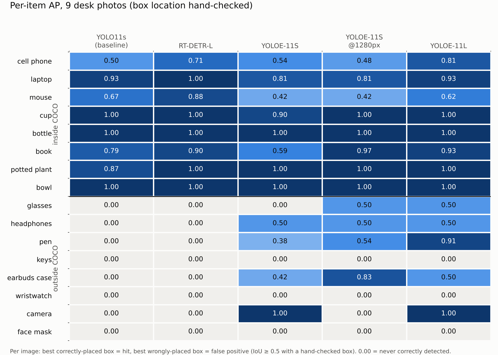
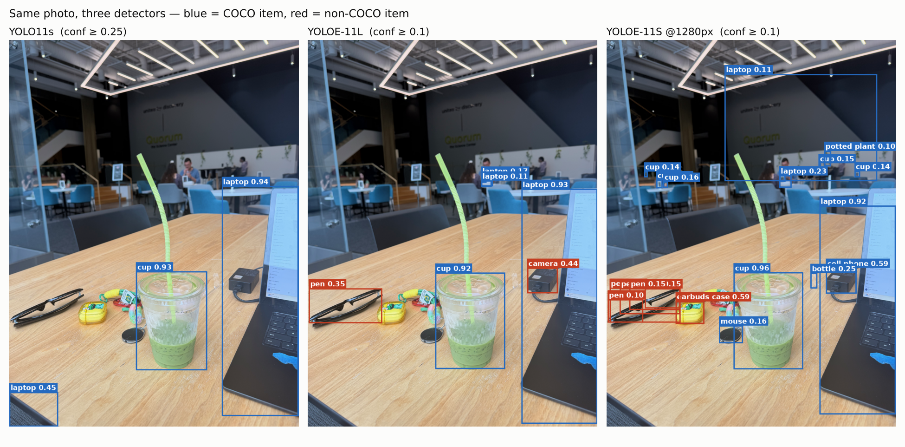

# LastSeen: Detector Comparison (iteration 1)

CIS 581 · Group 27 · Nov 2026

All models below were run on **the same 9 desk/room photos** and scored on **the same fixed list of 16 query items**: 8 items in COCO (the dataset most detectors are trained on) and 8 items outside it, which are the kind of things people actually lose.

| Inside COCO (8) | Outside COCO (8) |
|---|---|
| cell phone, laptop, mouse, cup, bottle, book, potted plant, bowl | glasses, headphones, pen, keys, earbuds case, wristwatch, camera, face mask |

## Main results

| Model | Architecture | Open-vocab | Params (M) | CPU ms/img | mAP (all 16) | mAP COCO | mAP non-COCO | Recall COCO | Recall non-COCO | Precision | Items found /16 |
|---|---|---|---|---|---|---|---|---|---|---|---|
| YOLO11s (baseline) | CNN, one-stage | no | 9.5 | 306 | 0.42 | 0.84 | 0.00 | 0.79 | 0.00 | 0.79 | 8 |
| RT-DETR-L | Transformer (DETR) | no | 33.0 | 1189 | 0.47 | **0.94** | 0.00 | **0.91** | 0.00 | 0.72 | 8 |
| YOLOE-11S | CNN + MobileCLIP text | yes | 13.7 | 452 | 0.53 | 0.78 | 0.29 | 0.71 | 0.25 | 0.68 | 9 |
| YOLOE-11S @1280px | CNN + MobileCLIP text | yes | 13.7 | 1505 | 0.57 | 0.83 | 0.30 | 0.76 | **0.38** | 0.62 | **11** |
| YOLOE-11L | CNN + MobileCLIP text | yes | 35.2 | 1066 | **0.67** | 0.91 | **0.43** | 0.76 | 0.31 | **0.82** | 10 |
| Faster R-CNN R50-FPN v2 | CNN, two-stage | no | 43.7 | *pending* | | | | | | | |
| YOLO-World v2-S | CNN + CLIP text | yes | | *pending* | | | | | | | |
| OWLv2 B/16 | ViT (Transformer) | yes | | *pending* | | | | | | | |

*Pending rows: code is ready (`benchmark/compare_models.py`); the weights are hosted on sites our compute environment couldn't reach, so these run in Colab next.*

Recall and precision use each model's default confidence threshold (0.25). mAP doesn't depend on a threshold. Runtime is CPU-only (2 threads) and includes inference but not image loading. Use it to compare models with each other, not as absolute speeds.

## What we learned

1. **The vocabulary matters more than the architecture.** Both closed-set models (CNN and Transformer) are strong on COCO items, but they score **0 on all 8 non-COCO items**: they have no class for keys, glasses or earbuds. Switching to a different closed-set model won't fix this.
2. **On COCO items, RT-DETR is the most accurate** (mAP 0.94 vs 0.84 for the baseline), especially for phones and mice, but it costs about 4× the runtime and 3.5× the parameters.
3. **Open-vocabulary detection unlocks the missing items.** YOLOE correctly finds 2 to 5 of the 8 non-COCO item types (pen, headphones, earbuds case, camera, glasses). **YOLOE-11L has the best overall mAP (0.67) and precision (0.82)**, while staying close to RT-DETR on COCO items (0.91).
4. **Resolution matters for small items.** Running the same YOLOE-11S at 1280 px instead of 640 px raises non-COCO recall from 0.25 to 0.38, earbuds-case AP from 0.42 to 0.83, and glasses AP from 0 to 0.5, at 3.3× the runtime. That's direct evidence for our planned **SAHI tiling** step, which gets the extra pixels without resizing the whole photo.
5. **Open-vocab confidence scores are low and labels get confused.** Correct non-COCO hits often score 0.1 to 0.3, under the default 0.25 threshold. Common mistakes: sunglasses labeled "pen", a laptop charger labeled "camera", a keyboard labeled "keys". The threshold needs tuning per model, and prompt wording is worth testing.
6. **Still unsolved by every model: keys, wristwatch and face mask.** These are the next targets (prompt variants, tiling, larger models).

## How it's scored

- **Ground truth** (`benchmark/ground_truth.json`): for each of the 9 images, every item is marked present, absent, or ambiguous (ambiguous cases are ignored).
- **Localization check** (`benchmark/verified_boxes.json`): every box that any model put on an image containing the item, at confidence ≥ 0.1 plus each model's top boxes, was checked by hand as correct or wrong. 288 boxes were reviewed. A detection counts only if it overlaps a box checked as correct (IoU ≥ 0.5). Without this check, numbers were inflated: for example, a "keys" box on a keyboard used to count as finding the keys.
- **Per item and image**: the best correctly placed box is one hit, and the best wrongly placed box is one false positive. **AP** ranks all of these by confidence. **Recall** is the share of images containing the item that have a correct hit above the threshold.

## Limitations (and next iteration)

- **Small test set.** 9 images with 1 to 6 positives per item, so one image can move an item's AP by 0.3 to 0.5. Read the trends, not the second decimal.
- **Mostly web photos**, plus 1 real photo (image 9). Next: 30 to 50 of our own photos with full box labels (low light, blur, clutter, occlusion, same-class distractors), then standard box-level AP@0.5.
- Results in the next iteration: the three pending models, SAHI on/off, and prompt variants. The same table will be reported every iteration.
